# TP2-DAR2026 : Les sockets en mode connecté TCP : E/R de CC & objets

**Nom et prénom :** Aicha Masmoudi

**Filière et Groupe :** LSI3.1.1

# Activité 2-1 : Échange de CC entre Client/Serveur via les Sockets TCP

## Étape 1 : Préparation de l'espace de travail
J'ai créé le répertoire de travail `Aicha Masmoudi_LSI3_DevAppReparties` qui contient le projet `TP2-DAR2026`.

Dans ce projet, j'ai repris les packages du TP1 : `serverPackage` (classe `Server2`) et `clientPackage` (classe `Client2`).

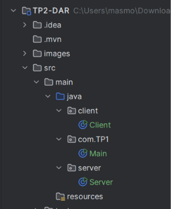


**Interprétation :** le projet contient un package pour le serveur et un package pour le client, comme dans l'Activité 1-2 du TP1.

## Étape 2 : Application des flux de traitement de CC

Dans l'Activité 1-2 du TP1, le client et le serveur n'échangeaient qu'un seul entier (octet). J'ai étendu les deux applications pour que le client puisse envoyer une **opération complète** (par exemple `55 * 25`). L'échange se fait avec des chaînes de caractères grâce aux méthodes `writeUTF()` et `readUTF()` des classes `DataOutputStream` et `DataInputStream` du package `java.io`.

### Fonctionnement du client (`Client2`)
1. Le client lit l'opération saisie au clavier avec un `Scanner`.
2. Il **valide la syntaxe** avant l'envoi, avec une expression régulière (`Pattern` et `Matcher`) : une chaîne incorrecte comme `25 ** 55` ou `abc + 3` n'est jamais envoyée au serveur.
3. Il envoie au serveur les trois éléments de l'opération : le premier opérande, l'opérateur et le deuxième opérande.
4. Il lit le résultat renvoyé par le serveur et l'affiche.
5. La saisie de `fin` arrête la communication : le client envoie `FIN` au serveur puis ferme son socket.

### Fonctionnement du serveur (`Server2`)
1. Le serveur crée une socket d'écoute sur le port 1234 et attend la connexion d'un client avec `accept()`.
2. Il lit les trois éléments de l'opération avec `readUTF()`.
3. Il calcule le résultat selon l'opérateur (`+`, `-`, `*`, `/`).
4. Il renvoie le résultat au client avec `writeUTF()`.
5. En cas de problème (division par zéro, opérateur inconnu, opérande invalide), il renvoie un message `ERREUR : ...` au lieu de planter.
6. Quand il reçoit `FIN`, il sort de sa boucle et ferme ses sockets.

### Lancement du serveur
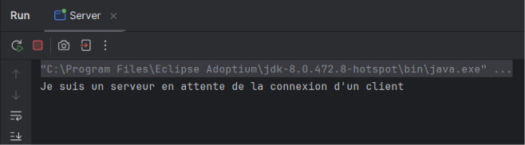


**Interprétation :** le serveur crée une socket d'écoute sur le port 1234, puis reste bloqué sur `accept()` en attendant la connexion d'un client.

### Addition
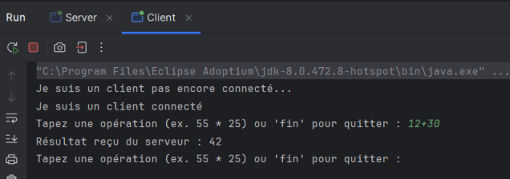

**Interprétation :** le client envoie `12`, `+` et `30` ; le serveur calcule la somme et renvoie `42`, que le client affiche.

### Soustraction
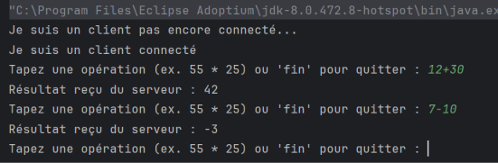

**Interprétation :** `7 - 10` donne bien `-3` : les nombres négatifs sont correctement gérés.

### Multiplication
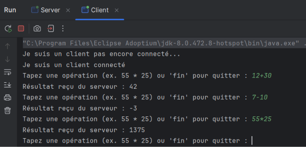


**Interprétation :** c'est l'opération de l'énoncé : `55 * 25` donne `1375`. Le client a envoyé l'opération entière en trois éléments, et le serveur a renvoyé le résultat.

### Division
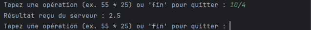


**Interprétation :** le calcul se fait avec des `double`, donc `10 / 4` donne `2.5`. Quand le résultat est entier, il est affiché sans `.0` (par exemple `1375`).

### Division par zéro
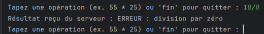


**Interprétation :** le serveur détecte que le deuxième opérande vaut 0 et renvoie `ERREUR : division par zéro`. Le client l'affiche et peut continuer à saisir d'autres opérations.

### Validation de la syntaxe côté client
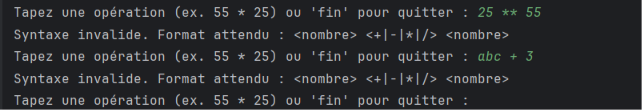
**Interprétation :** les saisies `25 ** 55` et `abc + 3` sont refusées par le client avec le message « Syntaxe invalide ». Rien n'est envoyé au serveur : c'est la validation demandée dans l'énoncé.

### Fin de la communication
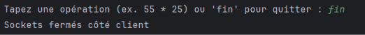

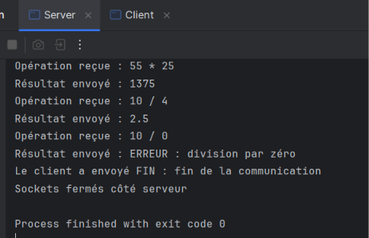


**Interprétation :** quand l'utilisateur saisit `fin`, le client l'envoie au serveur sous la forme `FIN`. Les deux programmes sortent de leur boucle et ferment leurs sockets : la communication s'arrête proprement.
# Activité 2-2 : Échange des objets entre Client/Serveur via les Sockets TCP

## Étape 1 : Préparation de l'espace de travail
J'ai ajouté à mon projet `TP2-DAR2026` les classes de cette activité, sans modifier celles de l'Activité 2-1 :

- le package `model` avec la classe `Operation` (l'objet échangé) ;
- la classe `ServerObjet` dans le package `server` ;
- la classe `ClientObjet` dans le package `client`.
  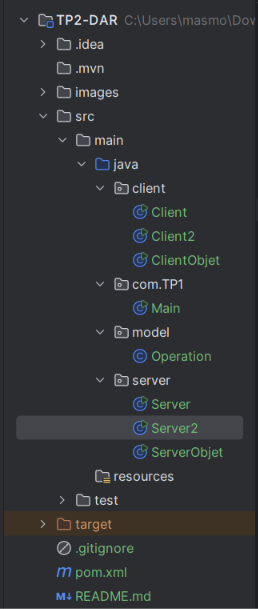


**Interprétation :** la classe `Operation` est placée dans un package à part, car le client **et** le serveur ont besoin de la même classe pour envoyer et recevoir l'objet.

## Étape 2 : Implémentation de l'échange d'objets

### a) Classe `Operation` (Serializable)
J'ai créé la classe `Operation` qui implémente l'interface `Serializable`. Elle contient les trois arguments de l'opération : `operande1`, `operateur` et `operande2`, avec leurs getters.

```java
public class Operation implements Serializable {
    private static final long serialVersionUID = 1L;
    private double operande1;
    private String operateur;
    private double operande2;
    //...
}
```

**Interprétation :** `Serializable` est une interface sans méthode : elle indique à Java que les objets de cette classe peuvent être transformés en suite d'octets pour être envoyés dans un flux, puis reconstruits de l'autre côté.

### b) Le client envoie un objet
Le client lit la saisie, vérifie la syntaxe avec la même expression régulière qu'à l'Activité 2-1, puis crée **un seul objet** `Operation` et l'envoie avec `ObjectOutputStream.writeObject()`. Il n'envoie donc plus trois chaînes séparées.

### c, d, e, f) Le serveur reçoit, récupère, calcule et répond
1. Le serveur reçoit l'objet avec `ObjectInputStream.readObject()` (c).
2. Il le convertit en `Operation` et récupère les données avec `getOperande1()`, `getOperateur()` et `getOperande2()` (d).
3. Il effectue le calcul selon l'opérateur (e).
4. Il renvoie le résultat au client avec `writeObject()` (f). En cas de division par zéro ou d'opérateur inconnu, il renvoie un message `ERREUR : ...`.
### g) Le client lit et affiche le résultat
Le client lit la réponse avec `readObject()` et l'affiche.

### Lancement du serveur
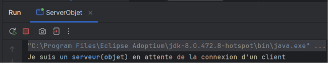

**Interprétation :** le serveur écoute sur le port 1234 et attend la connexion d'un client.

### Multiplication
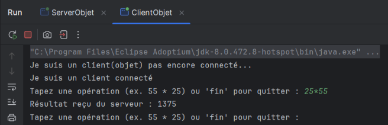


**Interprétation :** le client envoie l'objet `25 * 55`, le serveur affiche l'objet reçu et renvoie `1375`.

### Division
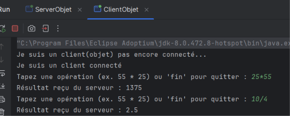


**Interprétation :** `10 / 4` donne `2.5`, car les opérandes de l'objet sont de type `double`.

### Division par zéro
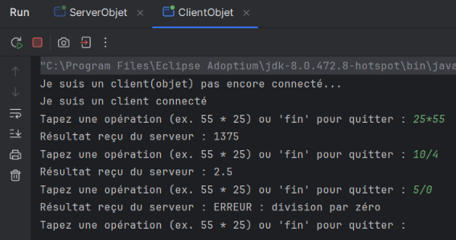

**Interprétation :** le serveur détecte que `operande2` vaut 0 et renvoie `ERREUR : division par zéro` au lieu de planter.

### Syntaxe invalide
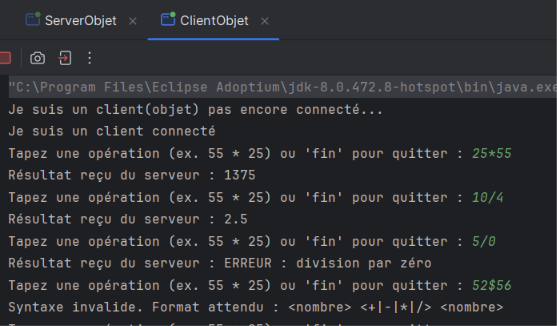


**Interprétation :** `25 ** 55` est refusée par le client : aucun objet n'est créé ni envoyé.

### Fin de la communication
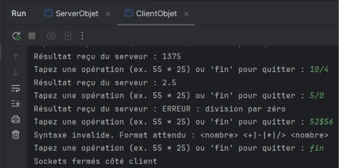


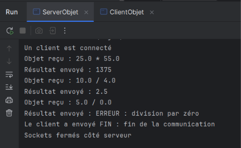


**Interprétation :** la saisie de `fin` envoie la chaîne `FIN` au serveur. Les deux programmes sortent de leur boucle et ferment leurs sockets.

### Remarque : ordre de création des flux d'objets
Côté serveur comme côté client, je crée d'abord l'`ObjectOutputStream`, je fais un `flush()`, puis je crée l'`ObjectInputStream`. Le constructeur de `ObjectInputStream` attend l'en-tête envoyé par l'autre `ObjectOutputStream` : si les deux côtés créaient d'abord leur flux d'entrée, les deux programmes resteraient bloqués.


# Conclusion générale

Ce TP m'a permis de passer de l'échange d'un seul entier à l'échange de **chaînes de caractères** puis d'**objets** entre un client et un serveur avec les sockets TCP en Java.

- **Activité 2-1 :** le client envoie l'opérande 1, l'opérateur et l'opérande 2 sous forme de chaînes (`DataInputStream` / `DataOutputStream` avec `readUTF()` / `writeUTF()`). Le serveur calcule et renvoie le résultat.
- **Activité 2-2 :** le client envoie un seul objet `Operation` qui implémente `Serializable` (`ObjectOutputStream` / `ObjectInputStream` avec `writeObject()` / `readObject()`). Le serveur récupère ses données, calcule et renvoie le résultat.
#### Avec un objet, les données liées forment une seule unité ; le code est plus clair que l'envoi de trois chaînes séparées.
